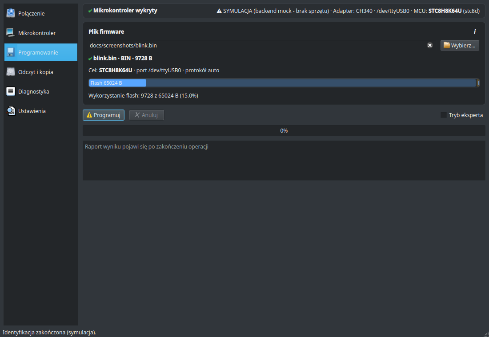
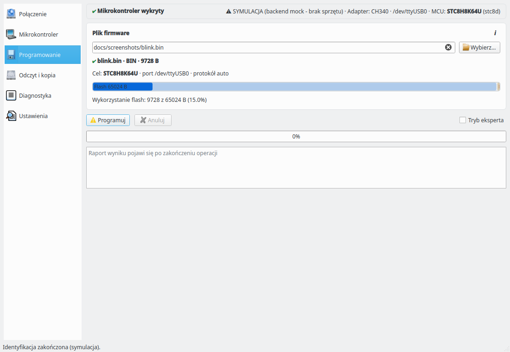
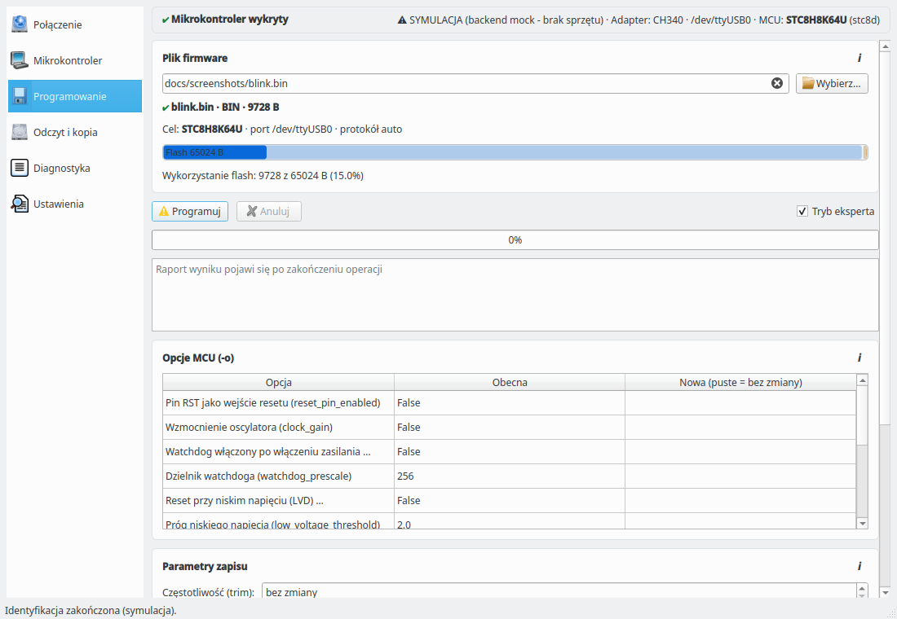
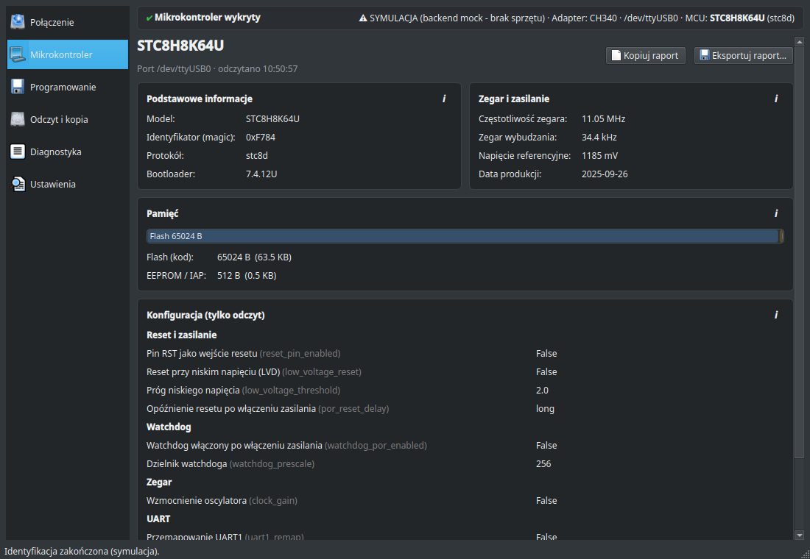
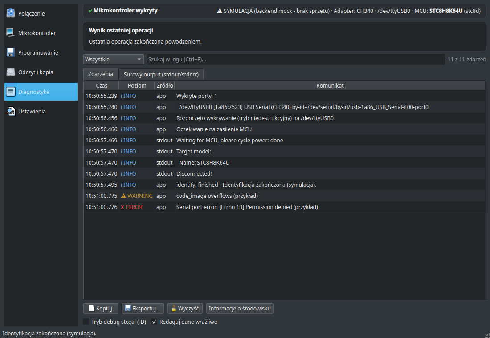
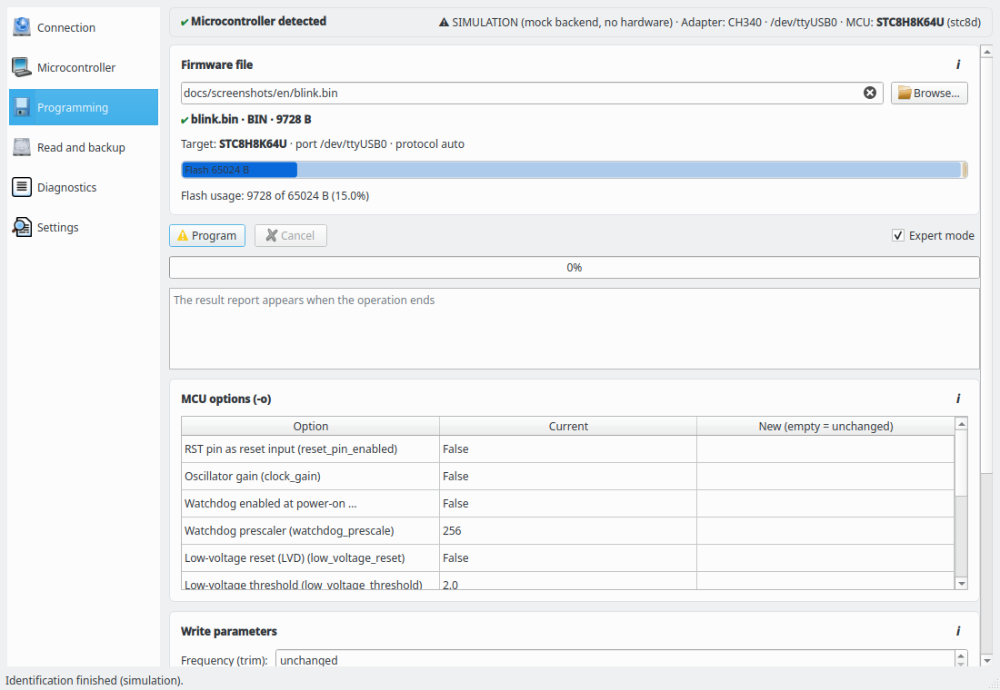
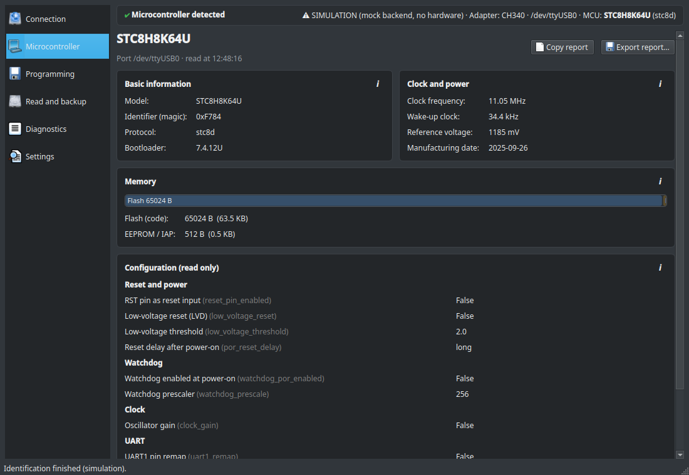
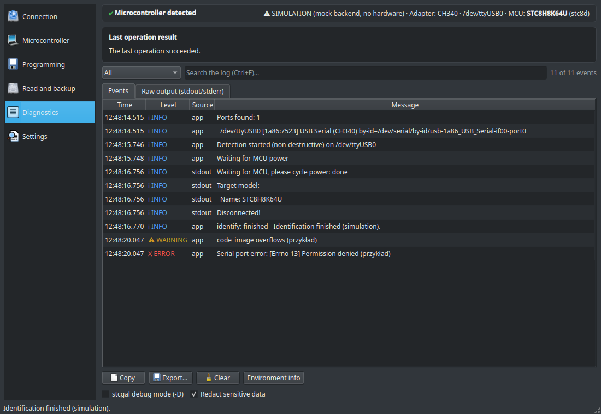

<div align="center">

# STC Programmer GUI

**Graficzny programator i diagnostyka mikrokontrolerów STC (8051) przez UART/ISP.**
*Short English summary: a cross-platform (Linux, Windows) GUI for programming and diagnosing STC 8051 MCUs over UART/ISP, built on stcgal 1.10. The UI is bilingual (English and Polish), with a simple basic mode and an expert mode.*
Jedna baza kodu dla Linuksa i Windows. Backend: [stcgal](https://github.com/grigorig/stcgal) 1.10.

[](https://github.com/zvgelo/stcgal-gui/actions/workflows/build-windows.yml)
[](https://github.com/zvgelo/stcgal-gui/actions/workflows/build-linux.yml)




</div>

<div align="center">

[](https://suppi.pl/zvgelo)

</div>

## Najważniejsze cechy

- **Prosty tryb podstawowy:** wybierasz plik HEX/BIN i naciskasz jeden przycisk. Wszystkie szczegóły są pod przyciskami „i” i w dymkach.
- **Tryb eksperta** (wyłączony przy każdym uruchomieniu): edytor opcji `-o`, trim `-t`, offset i wypełnienie obrazu, zapis Flash + EEPROM, samo kasowanie Flash.
- **Niedestrukcyjna identyfikacja** układu: model, magic, zegar, wersja BSL, napięcie odniesienia, pamięć i konfiguracja. Raport można skopiować lub wyeksportować do Markdown/JSON.
- **Zabezpieczenia przed utratą danych:** brak zapisu bez potwierdzenia, kontrola zgodności modelu i rozmiaru, osobne ostrzeżenia o ryzyku. Szczegóły w [docs/SAFETY.md](docs/SAFETY.md).
- **Czytelna diagnostyka:** log zdarzeń z poziomami, filtrem i wyszukiwaniem, surowy stdout/stderr, eksport z redakcją danych osobistych.
- **Motywy:** systemowy, jasny, ciemny.
- **Języki:** polski i angielski (domyślnie język systemu, zmiana w Ustawieniach).
- **Bez roota i sudo.** Backend działa jako kontrolowany podproces, bez `shell=True`.

## Zrzuty ekranu

<table>
<tr>
<td width="50%"><br><sub>Tryb podstawowy: plik i jeden przycisk</sub></td>
<td width="50%"><br><sub>Tryb eksperta: opcje, trim, offset, EEPROM</sub></td>
</tr>
<tr>
<td><br><sub>Informacje o wykrytym układzie</sub></td>
<td><br><sub>Diagnostyka z logiem zdarzeń</sub></td>
</tr>
</table>

<details>
<summary>English screenshots</summary>

<table>
<tr>
<td width="50%"><br><sub>Basic mode: a file and one button</sub></td>
<td width="50%"><br><sub>Expert mode: options, trim, offset, EEPROM</sub></td>
</tr>
<tr>
<td><br><sub>Detected MCU information</sub></td>
<td><br><sub>Diagnostics with the event log</sub></td>
</tr>
</table>

</details>

Zrzuty pochodzą z trybu symulacji (`--mock`), generuje je `scripts/screenshots.py`.

## Pobieranie

Gotowe pakiety budują workflowy GitHub Actions (zakładka *Actions*, artefakty ostatniego przebiegu).

| System | Artefakt |
|---|---|
| Windows 10/11 x64 | `STC-Programmer.exe` (jeden plik, backend w środku) oraz instalator `STC-Programmer-Setup-x64.exe` |
| Linux, dowolna dystrybucja | `.AppImage`, `.tar.gz` |
| Debian / Ubuntu | `.deb` |
| Fedora / RHEL | `.rpm` |

Pakiety Linux są budowane na glibc 2.35 i działają także na nowszych dystrybucjach. Na Ubuntu/Debian do Qt (xcb) bywa potrzebny pakiet `libxcb-cursor0`. Użytkownik musi należeć do grupy `dialout` (Fedora, Debian) lub odpowiednika, aby otworzyć `/dev/ttyUSB0`. Szczegóły: [docs/CH340.md](docs/CH340.md).

## Szybki start

1. **Połączenie** (`Ctrl+1`): wybierz port adaptera (np. CH340), protokół zostaw na `auto`.
2. Naciśnij **Wykryj mikrokontroler** (`Ctrl+D`), a potem wyłącz i włącz zasilanie MCU, nie odłączając adaptera.
3. **Programowanie** (`Ctrl+O`): wybierz plik, naciśnij **Programuj** i potwierdź w oknach z podsumowaniem.

Pozostałe widoki: **Mikrokontroler** (informacje i konfiguracja), **Odczyt i kopia** (eksport informacji o układzie), **Diagnostyka** (`Ctrl+5`), **Ustawienia** (`Ctrl+S`).

## Tryby programowania

| | Podstawowy | Ekspert |
|---|---|---|
| Plik HEX/BIN | tak | tak |
| Opcje `-o`, trim `-t` | nie | tak, z potwierdzeniem ryzyka |
| Offset i wypełnienie obrazu | nie | tak |
| Zapis EEPROM | nie | tak, osobne potwierdzenie |
| Samo kasowanie Flash | nie | tak, osobne potwierdzenie |

## Instalacja ze źródeł

Wymagania: Python 3.12+, `stcgal` (`pipx install stcgal`) oraz dostęp do portu szeregowego.

```bash
./scripts/install.sh        # venv w ~/.local/share/stcgal-gui, launcher, .desktop, ikona
stcgal-gui
./scripts/uninstall.sh
```

Tryb deweloperski:

```bash
python3 -m venv .venv && .venv/bin/pip install -e '.[dev]'
.venv/bin/python -m stcgal_gui           # prawdziwy backend
.venv/bin/python -m stcgal_gui --mock    # symulacja bez sprzętu
.venv/bin/pytest && .venv/bin/ruff check . && .venv/bin/mypy stcgal_gui
```

## Budowanie pakietów

```bash
./scripts/build-linux.sh                  # tar.gz, deb, rpm, AppImage (zależnie od narzędzi)
./scripts/build-windows.sh                # Fedora + Wine, wynik w dist/windows
```
```powershell
scripts\build-windows.ps1 -Installer      # natywny Windows, exe + instalator Inno Setup
```

Workflowy `build-windows.yml` i `build-linux.yml` uruchamia się ręcznie (*workflow_dispatch*). Opis budowania: [docs/BUILD-WINDOWS.md](docs/BUILD-WINDOWS.md), uwagi o Windows: [docs/WINDOWS.md](docs/WINDOWS.md).

## Bezpieczeństwo danych

stcgal 1.10 nie potrafi zagwarantować zachowania EEPROM ani bajtów opcji: kasowanie bywa pełne, a opcje i trim są zapisywane po każdym programowaniu. Aplikacja nie ukrywa tego przed użytkownikiem:

- identyfikacja nigdy nie dostaje pliku ani flag `-e`, `-o`, `-t`,
- zapis wymaga świeżej identyfikacji i zgodności modelu,
- ryzyka są pokazywane przed zapisem, a okna potwierdzeń domyślnie wybierają *Anuluj*,
- rozbieżność modelu przerywa operację przed kasowaniem,
- po zapisie nie ma fałszywej „weryfikacji”, bo stcgal jej nie wykonuje.

Pełna analiza źródeł stcgal i polityka aplikacji: [docs/SAFETY.md](docs/SAFETY.md).

## Ograniczenia

- Odczyt firmware z układu jest niemożliwy w protokole ISP STC. Aplikacja czyta tylko identyfikator, parametry i bajty opcji.
- Anulowanie w trakcie zapisu może zostawić niepełne firmware. Bootloader ISP pozostaje dostępny, wystarczy zaprogramować ponownie.
- Tryb USB-ISP (`usb15`) nie jest obsługiwany ani testowany.

## Status testów

- Testy automatyczne (`pytest`, `pytest-qt`, `ruff`, `mypy`) przechodzą na Linuksie i Windows w CI.
- Identyfikacja fizycznego STC8H8K64U (CH340, protokół `stc8d`) została potwierdzona na sprzęcie.
- Zapis i kasowanie na fizycznym układzie oraz praca z adapterem na prawdziwym Windows **nie były testowane**. Korzystasz na własną odpowiedzialność.

## Struktura repozytorium

```
stcgal_gui/        aplikacja (core, backends, gui)
tests/             testy jednostkowe i GUI
scripts/           instalacja, budowanie pakietów, zrzuty ekranu
packaging/         PyInstaller, Inno Setup, pakiety Linux
docs/              architektura, bezpieczeństwo, Windows, CH340
.github/workflows/ budowanie Windows i Linux
```

Architektura: [docs/ARCHITECTURE.md](docs/ARCHITECTURE.md).

## Języki / Languages

Interfejs jest dostępny po polsku i angielsku. Domyślnie używany jest język systemu (polski dla `pl`, w pozostałych przypadkach angielski). Zmiana: **Ustawienia → Język** (zadziała po ponownym uruchomieniu) albo jednorazowo `stcgal-gui --lang en`.

The UI is available in Polish and English. By default it follows the system language (Polish for `pl`, English otherwise). Change it in **Settings → Language** (applies after a restart) or once with `stcgal-gui --lang en`.

Teksty źródłowe są po polsku i opakowane w `tr()` / `QCoreApplication.translate()`. Angielski: `stcgal_gui/resources/translations/stcgal_gui_en.ts` (źródło) i `.qm` (skompilowany, w repozytorium). Po zmianie tekstów:

```bash
pyside6-lupdate $(find stcgal_gui -name '*.py') -ts stcgal_gui/resources/translations/stcgal_gui_en.ts -no-obsolete -locations none
# uzupełnij brakujące tłumaczenia (Qt Linguist), potem:
pyside6-lrelease stcgal_gui/resources/translations/stcgal_gui_en.ts -qm stcgal_gui/resources/translations/stcgal_gui_en.qm
```

Nowy język: dodaj `stcgal_gui_<kod>.ts` (np. `de`), skompiluj do `.qm` i dopisz kod do `LANGUAGES` w `stcgal_gui/core/i18n.py` oraz do listy w Ustawieniach. Test `tests/test_i18n.py` pilnuje, żeby w katalogu angielskim nie było nieprzetłumaczonych wpisów.

## Licencja

MIT, patrz [LICENSE](LICENSE). Komponenty zewnętrzne (stcgal, Qt/PySide6, pyserial): [THIRD-PARTY-NOTICES.md](THIRD-PARTY-NOTICES.md).
